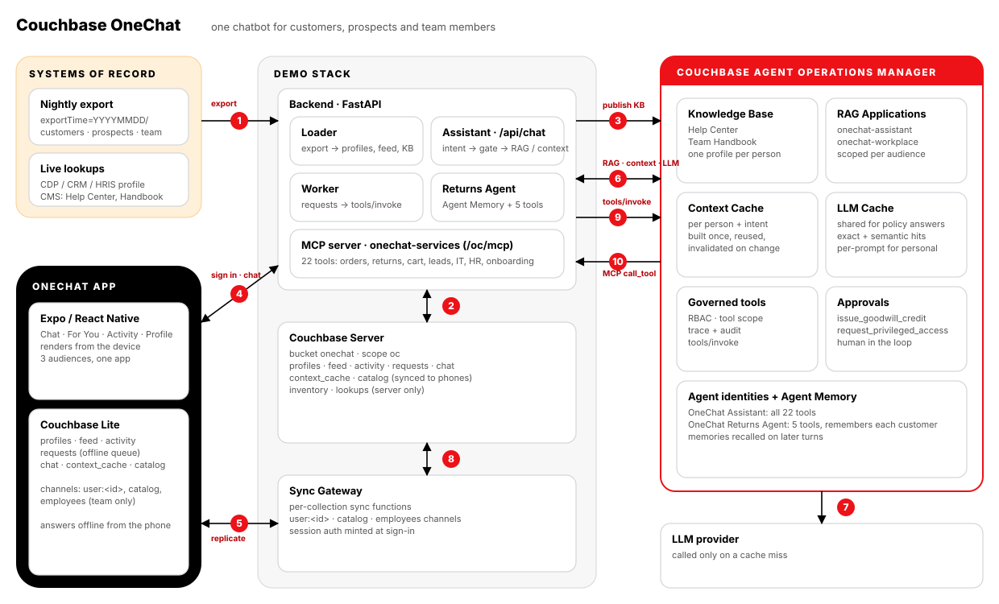
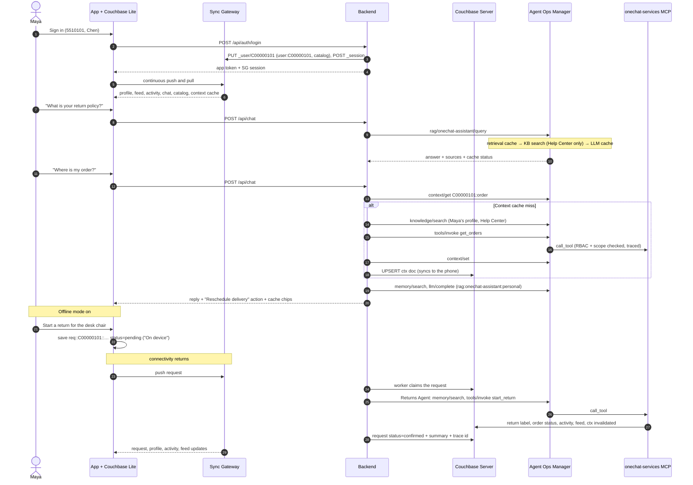
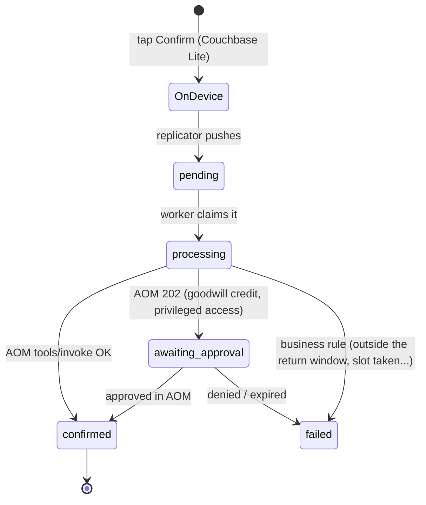

# Couchbase OneChat · Mobile AI Personalization Demo


One chatbot for the whole company. **OneChat** is a mobile assistant for the fictional retailer **Larkfield** that serves three audiences from one app, one knowledge plane and one governed tool set:

| Area | Who asks | What OneChat does |
|---|---|---|
| **Customer Support & FAQs** | Customers, prospects | Store hours, delivery times, return policy, pricing, account details |
| **E-Commerce & Order Tracking** | Customers | Order status and shipment tracking, delivery reschedules, returns and exchanges, abandoned-cart recovery |
| **Lead Generation & Sales** | Prospects | Captures contact details, qualifies the lead, guides product discovery, books a consultation |
| **Internal Operations & HR** | Team members | IT help desk tickets, password resets and access requests, benefits questions, time off, onboarding paperwork |

Under it sits the Couchbase stack: **Couchbase Lite** on the phone, **Sync Gateway**, **Couchbase Server**, and the **Couchbase Agent Operations Manager (AOM)** for the AI plane:

* answers are grounded in AOM's **Knowledge Base** (a Help Center for everyone, a Team Handbook for employees only, and one profile document per person)
* OneChat is registered as two AOM **RAG Applications** (`onechat-assistant`, `onechat-workplace`), so queries, cache hits and savings show per audience on AOM's *RAG Applications* page
* the context built for each personal answer is cached in AOM's **Context Cache** and in Couchbase, which syncs it to the phone for offline answers
* LLM calls go through AOM's **LLM Caching** gateway: a policy question one person paid for is free for the next person
* every action (returns, checkout, consultations, IT tickets, time off, benefits) runs as an RBAC-checked, traced and audited AOM **tool call**, with human approval for goodwill credits and privileged access
* a second agent, the **OneChat Returns Agent**, handles returns with a narrower tool scope and **Agent Memory**

The app's structure follows the Princess / Royal Caribbean mobile RAG personalization demos and [Fujio-Turner/mobile_field_service](https://github.com/Fujio-Turner/mobile_field_service): Expo / React Native, Couchbase Lite via `cbl-reactnative`, and a browser preview engine that syncs the same documents over REST. The look follows couchbase.com: black, white and Couchbase red, with the Couchbase logo.

---

## How the demo opens

`https://<host>:5150/story` is an eight-chapter story for the room before the live app, about what it costs to run one chatbot for a whole company and how the Couchbase stack cuts that cost.

1. **Title.** One chatbot for customers, prospects and team members.
2. **Four jobs.** The four use-case areas, usually four separate bots.
3. **What breaks.** Repeat questions, context rebuilt every turn, unscoped retrieval (an HR answer leaking to a customer), and nothing at all offline.
4. **How it usually gets built.** Every box between the question and the answer is a bill. Press **Transform the stack**, or **T**.
5. **Five questions, two bills.** The same questions walked through an AOM-governed OneChat and a plain chatbot, with a running LLM spend on each phone.
6. **Build the context once.** Nightly export to Couchbase to the AOM Knowledge Base, RAG apps and caches, and on to the phone, with live numbers from this demo.
7. **Question by question.** Cost with a model call every time versus through the caches.
8. **See it run.** Links to the app and AOM, a short script, the company workload and the reset button.

The page is served by the `web` container (`web/story.html`); its live numbers come from `/api/status`.

## What the demo shows

| Concept | Where you see it |
|---|---|
| **One app, three audiences** | Sign in as a customer, a prospect or a team member: the chat starters, *For You* cards, activity list and quick actions all change. The phone only ever holds that person's documents. |
| **Audience-scoped knowledge** | The Team Handbook lives in its own RAG application and its own Sync Gateway channel (`employees`). A customer who asks about PTO or the VPN gets a polite refusal with nothing retrieved (`restricted: true`). |
| **Couchbase Lite: offline and online** | Every screen renders from the on-device database. *Profile → Offline mode* pauses replication: actions queue as `requests` documents ("On device") and questions already answered are answered again from the phone. |
| **AOM RAG Applications** | Policy questions ("What is your return policy?") go to `POST /v1/agent/rag/<app>/query`: retrieval cache, Knowledge Base search scoped to one document, LLM cache. |
| **Context Caching** | Personal questions ("Where is my order?") assemble context once per person and intent - profile document, policy chunks, governed tool results - and store it in AOM's Context Cache and in `context_cache` in Couchbase. Follow-ups reuse it; any change to the person's data invalidates it. |
| **LLM Caching** | Policy answers contain no personal data, so they are shared across everyone (`rag:<app>:playbook`). Personal answers are cached per prompt (`rag:<app>:personal`). The chat shows a chip for each: `Context cache · built / hit`, `LLM cache · miss / exact / semantic`. |
| **Governed actions** | 22 tools on the `onechat-services` MCP server, called through `POST /v1/tools/invoke` as the *OneChat Assistant* agent. `issue_goodwill_credit` and `request_privileged_access` sit behind AOM's approval tier. |
| **A second agent + Agent Memory** | **Confirm** on a return creates a request the worker hands to the *OneChat Returns Agent*: it recalls what the customer told us before, runs the return through its five tools, and remembers the outcome. |

---

## Architecture



| # | Flow |
|---|---|
| **1** | Every night an `exportTime=YYYYMMDD` JSON Lines partition of customers, prospects and team members lands in the export folder. The loader picks up the newest one with a `_SUCCESS` marker. |
| **2** | The loader upserts every profile, builds each person's *For You* feed and activity list, and publishes the catalog (and the employee-only handbook document) in Couchbase Server. |
| **3** | The loader replaces the AOM **Knowledge Base** documents (Help Center, Team Handbook, one profile per person up to `KB_PROFILE_LIMIT`) and re-scopes the two **RAG Applications** to today's documents. |
| **4** | Sign-in: the backend creates the person's Sync Gateway user (channels `user:<id>`, `catalog`, plus `employees` for team members) and mints a session. |
| **5** | **Couchbase Lite** replicates continuously with Sync Gateway. Every screen renders from the phone; taps become `requests` documents saved locally. |
| **6** | Chat goes to `/api/chat`. Policy questions go to the audience's RAG Application in one call. Personal questions check AOM's Context Cache; on a miss the assistant builds context from the Knowledge Base, the system of record and read-only tools, then caches it. |
| **7** | AOM calls the LLM provider only on a cache miss. |
| **8** | Sync Gateway carries requests up and results back down. |
| **9** | The worker runs each request through `POST /v1/tools/invoke` (returns go to the Returns Agent), so RBAC, tool scope, the approval tier, a trace and an audit entry are applied. |
| **10** | AOM calls the `onechat-services` MCP server, which applies the change in Couchbase; the updated profile, activity and feed sync back to the phone. |

### A customer's workflow, end to end



A goodwill credit or a privileged-access request follows the same path, except AOM answers `202 pending_approval`: the request shows **Awaiting approval** on the phone until someone approves it on AOM's *Approvals* page.

### Offline-first request lifecycle



---

## Quick start

### 1. Browser preview in about 2 minutes (no Docker, no AOM)

The backend can run on an in-memory store, and the app has a browser preview engine that syncs the same documents over REST. Use this to look at the UX; Couchbase Lite needs a device build (step 3).

```bash
python3 datagen/generate_mock_export.py             # 24 MiB export → data/onechat-export/exportTime=<today>/
cd backend && python3 -m venv .venv && . .venv/bin/activate && pip install -r requirements.txt
uvicorn app.main:app --port 8200                    # STORE_DRIVER=memory by default
# new terminal
cd mobile && npm install && npx expo start --web    # sign in with a demo persona
```

Without AOM the assistant writes its answers itself from the same context, so every flow works; the cache chips simply report "not connected".

### 2. Full stack: Couchbase, Sync Gateway and AOM

You need Docker Desktop, and the [Couchbase Agent Operations Manager](https://github.com/erikhinderer/couchbase-agent-operations-manager) running on the same machine at `https://localhost:8090` with its admin password set.

```bash
python3 datagen/generate_mock_export.py
cp .env.example .env
./scripts/setup-corporate-ca.sh            # only behind a TLS-inspecting proxy (Zscaler etc.)
docker compose up -d --build               # couchbase, init, sync-gateway, sg-init, backend, web
docker compose logs -f backend             # wait for "Loaded export …"

python3 scripts/register_with_aom.py --admin-password '<AOM admin password>'
docker compose up -d --build backend       # picks up AOM_* from .env, publishes the KB, scopes the RAG apps
```

`register_with_aom.py` is idempotent; `--rotate` issues new agent keys. After it runs, AOM shows:

* **Agents**: *OneChat Assistant* (all 22 `onechat-services::*` tools) and *OneChat Returns Agent* (5 tools; key written to `.env` as `AOM_RETURNS_AGENT_API_KEY`)
* **Servers / Catalog**: `onechat-services` (trusted) and its tools
* **Knowledge**: the Help Center, the Team Handbook and per-person profile documents
* **Approvals config**: `issue_goodwill_credit` and `request_privileged_access` require a human
* **RAG Applications**: `onechat-assistant` (Help Center) and `onechat-workplace` (Team Handbook)
* **Context Cache**: entries in `rag:<app>:user-context`, one per person and intent

Configure an LLM provider key in AOM to get generated answers. Without one, AOM returns a labelled stub, the backend writes the answer from the same retrieved context, and AOM still reports the cache status.

| Port | Service |
|---|---|
| `5150` | **The app in a browser** over HTTPS, behind the sign-in page, inside a phone frame (`?frame=0` for full width), and the story at `/story` |
| `8202` | Backend API + MCP server (`/oc/mcp`); `/` lists every link |
| `4988` | Sync Gateway public, which is what phones replicate with: `ws://<host>:4988/onechat` |
| `127.0.0.1:4989` | Sync Gateway admin |
| `127.0.0.1:18093` | Couchbase Web Console (Administrator / password123) |

**Sign-in and HTTPS.** The browser UI (the app, the story page and everything else the `web` container serves) is on **`https://<host>:5150`** and opens on a sign-in page:

| Username | Password |
|---|---|
| `demo` | `Couchbase123!` |

Change them with `DEMO_USERNAME` / `DEMO_PASSWORD` in `.env` (Compose) or `web.auth.username` / `web.auth.password` (Helm). The container serves a self-signed certificate it generates on first start, so the browser warns once; add the address people use to `TLS_HOSTS` (Compose) so it is in the certificate, or serve a real one by mounting `tls.crt` / `tls.key` at `/etc/nginx/tls` (Helm: `web.tls.secretName`). Plain `http://` on the same port redirects to HTTPS, and `/signout` ends the session. The sign-in covers the browser UI only: the backend API and Sync Gateway ports are unchanged.

The ports are chosen so this stack runs alongside AOM and the Royal Caribbean (8081 / 8200 / 4984) and Princess (8082 / 8201 / 4986) demos.

### 3. The app on a device with Couchbase Lite

Couchbase Lite is a native module, so it needs a **development build**; Expo Go can't load it. `npm install` runs `scripts/fetch-cbl-native.sh`, which fetches the `cbl-reactnative` native submodules that npm skips.

```bash
cd mobile
cp .env.example .env                       # API + Sync Gateway URLs (LAN IP for a physical phone)
npm install
npx expo run:ios -d "iPhone 16 Pro"        # or: npx expo run:android
```

With `EXPO_PUBLIC_DB_ENGINE=auto` the app uses Couchbase Lite whenever the native module is linked. *Profile → Offline & sync* shows the database, the Sync Gateway endpoint, the replicator status and how many documents are waiting to send.

The `web` service serves a prebuilt browser bundle (`web/dist.tgz`). After changing the app, rebuild it with `cd mobile && npm run export:web:docker`, then `docker compose up -d --build web`.

### 4. Kubernetes with Helm (K3s / Rancher)

`deploy/k8s/deploy.sh` deploys AOM (**agent-ops**) and this demo (**onechat-app**) onto a single-node K3s cluster without a container registry:

```bash
AOM_ADMIN_PASSWORD='<12+ characters>' ./deploy/k8s/deploy.sh          # MOTHER=ehind@192.168.111.4 by default
AOM_ADMIN_PASSWORD='<current AOM password>' ONLY=onechat ./deploy/k8s/deploy.sh   # AOM is already there
```

It builds the images, copies them over SSH into K3s's containerd, and runs `helm upgrade --install` for [`helm/onechat-app`](helm/onechat-app) with [`deploy/k8s/values-mother.yaml`](deploy/k8s/values-mother.yaml), which publishes **5150 / 8202 / 4988**. In the cluster the backend registers itself with AOM (`AOM_AUTO_REGISTER=true`): it adds the MCP server, issues both agent identities, turns on the approval tier and publishes the Knowledge Base and RAG applications. Progress is in `/api/status` under `aom.registration`. A CronJob writes a new export partition every morning and the backend picks it up.

`deploy/k8s/deploy-on-mother.sh` does the same from a clone on the node itself; `deploy/k8s/diagnose.sh` prints the state of every piece.

---

## Demo script (about 10 minutes)

Sign in with the account number and last name (the sign-in screen lists them).

1. **Maya Chen** · customer, Rewards Gold · `5510101` / `Chen`
   * *Chat*: "What is your return policy?" → `LLM cache · miss`. "Where is my order?" → `Context cache · built`, the shipment and delivery window, and a **Reschedule delivery** action. Ask again: `Context cache · hit`, `LLM cache · exact`.
   * *For You*: the order on its way, the monitor still in her cart with a comeback code, and the return window closing on her desk chair.
   * *Profile → Offline mode* **on**. Start a return for the desk chair (**On device**), then ask the return-policy question again (**Answered on device**). Switch it **off**: the return syncs and comes back **Confirmed** with a label. In AOM, show the trace for `onechat-services::start_return`, run by the Returns Agent, and its memory.
   * "My order arrived damaged and nobody has helped me" offers a **goodwill credit**, which shows **Awaiting approval**. Approve it in AOM → *Approvals* and the phone flips to **Confirmed**.
   * "How much PTO do I have?" is refused: workplace knowledge is not in a customer's scope.
2. **Daniel Okafor** · prospect, office manager at a 28-person studio · `5520202` / `Okafor`
   * "What is your return policy?" → **LLM cache exact hit** from Maya's question: shared knowledge, no personal data.
   * "We need to outfit a new office" → product guidance and a bundle sized for the team, then **Share your details** (lead capture and qualification) and **Book a consultation**.
3. **Sofia Alvarez** · team member, day 6 · `5530303` / `Alvarez`
   * *For You*: onboarding tasks, the benefits enrollment deadline, her open VPN ticket.
   * "My VPN keeps disconnecting" → her existing ticket and the handbook fix; "I need access to the finance system" → a privileged-access request behind the approval tier.
   * "How many PTO days do I have?" → answered, from the same question a customer was refused. Complete an onboarding task and request a day off.

## Company workload: the caches under load

Three personas show how the caches work; the workload shows what they do to a real queue. `POST /api/demo/workload` (the **Run company workload** button on the story page, or the script) plays people from all 12 groups - five customer regions, two prospect segments, five employee departments - against the assistant through the same path the phone uses.

```bash
python scripts/run_chatbot_workload.py                      # backend 192.168.111.4:8202 by default; --backend to change
python scripts/run_chatbot_workload.py --users-per-group 6 --turns 8 --concurrency 8 --groups CUS-NE,LEAD-SMB,EMP-CARE
python scripts/run_chatbot_workload.py --plan               # who asks what, without running
python scripts/run_chatbot_workload.py --hours 24           # paced to a day/night traffic curve
python scripts/run_chatbot_workload.py --status | --stop
```

Policy questions are drawn Zipf-style, so a few dominate: the canonical wording gives **exact hits** after the first person pays, `--paraphrase-ratio` of people reword it (**semantic hits**), the long tail misses. Personal questions build context once per person and intent, then hit. Statements ("I prefer afternoon deliveries") go to Agent Memory. The report is broken down by group, area, use case and cache outcome (`GET /api/demo/workload`), and the story page shows it live.

## Reset the demo

`POST /api/demo/reset` (the **Reset demo** button, or `python scripts/reset_demo.py`) puts the three personas, plus everyone who changed something since the load, back to today's export: requests, chat and cached context are deleted, profiles reloaded, inventory released, feeds rebuilt, and their AOM memories and OneChat's cache namespaces purged. Sync Gateway replicates the result to the phone. `--dry-run` shows who would be reset.

---

## Data model

Bucket `onechat`, scope `oc`. Sync Gateway replicates the first seven collections to Couchbase Lite under the same names.

| Collection | Document | Written by | Notes |
|---|---|---|---|
| `profiles` | `profile::<user>` | loader, actions | The export row + `rev` (bumped on every change) |
| `feed` | `feed::<user>` | personalization | Ranked *For You* cards, each with a call to action |
| `activity` | `activity::<user>` | actions | Orders, returns, consultations, tickets, tasks, time off |
| `requests` | `req::<user>::<uuid>` | **the phone** (create), worker (status) | Offline-first queue; the sync function allows only the owner to create a `pending` request |
| `chat` | `chat::<user>` | assistant | History, plus answers reusable offline |
| `context_cache` | `ctx::<user>::<intent>` | assistant | Phone copy of the AOM Context Cache entry |
| `catalog` | `catalog::v1`, `handbook::v1` | loader | Stores, products, bundles, FAQ (channel `catalog`); IT and HR reference (channel `employees`) |
| `inventory` | `inv::v1` | actions | Stock and consultation slots. Server only |
| `lookups` | login index, KB document ids, load state | loader | Server only |

Tools on `onechat-services`: read-only `get_user_context`, `get_orders`, `get_return_options`, `get_cart`, `recommend_products`, `get_consultation_slots`, `get_it_context`, `get_benefits_summary`, `get_onboarding_tasks`; actions `reschedule_delivery`, `start_return`, `issue_goodwill_credit` (approval), `checkout_cart`, `submit_lead_details`, `book_consultation`, `create_it_ticket`, `reset_password`, `request_system_access`, `request_privileged_access` (approval), `request_time_off`, `enroll_benefits`, `complete_onboarding_task`.

## Configuration

Backend variables go in `.env` (see `.env.example`); `docker-compose.yml` sets the infrastructure ones.

| Variable | Default | |
|---|---|---|
| `STORE_DRIVER` | `memory` (compose: `couchbase`) | `memory` keeps up to `MEMORY_MAX_PROFILES` people |
| `AOM_URL`, `AOM_AGENT_API_KEY` | — | Assistant agent identity, written by `register_with_aom.py` |
| `AOM_RETURNS_AGENT_API_KEY` | — | Returns Agent identity; blank = returns run as the assistant |
| `AOM_ADMIN_USERNAME`, `AOM_ADMIN_PASSWORD` | — | Used to publish KB documents |
| `AOM_LLM_PROVIDER`, `AOM_LLM_MODEL` | AOM default | Pin the model completions use |
| `RAG_APP_ID`, `RAG_APP_ID_WORKPLACE` | `onechat-assistant`, `onechat-workplace` | AOM RAG Application ids |
| `KB_PROFILE_LIMIT` | see `.env.example` | How many people get a KB profile document |
| `EXPORT_DIR`, `EXPORT_POLL_SECONDS` | `data/onechat-export` | Where the nightly export lands and how often to look |
| `SOR_PROFILE_API_URL`, `SOR_API_TOKEN`, `SOR_MOCK_LATENCY_MS` | — | Live profile lookup against the system of record (blank = mock from the export) |
| `CMS_KB_ENDPOINT`, `CMS_TOKEN` | — | Help Center / Handbook source (blank = bundled articles) |
| `SG_PUBLIC_URL` | — | Replication URL handed to phones |

App variables (`mobile/.env`): `EXPO_PUBLIC_API_URL`, `EXPO_PUBLIC_SG_URL`, `EXPO_PUBLIC_DB_ENGINE` (`auto` · `cbl` · `preview`).

## Tests

```bash
cd backend && pip install -r requirements.txt && pytest -q    # 32 tests
cd mobile && npm run typecheck
```

`test_demo_flows.py` covers all four areas, the audience gate, the context cache (hit, then invalidation after a change), the offline request flow, business-rule failures and push authorization. `test_aom_integration.py` and `test_aom_bootstrap.py` run the backend against `tests/fake_aom.py`, which has the same routes and shapes as AOM: KB publishing, both RAG applications and their scopes, the shared LLM cache, tool calls over real MCP, the approval tier and the Returns Agent.

## Repository layout

```
backend/            FastAPI API, MCP server, loader, worker, assistant (Python)
  app/catalog.py          Larkfield reference data: stores, products, bundles, IT and HR (shared with the generator)
  app/assistant.py        intent → audience gate → AOM RAG app (policy) | Context Cache → KB + memory + LLM cache (personal) → actions
  app/actions.py          business logic behind all 22 tools
  app/personalization.py  For You cards per audience
  app/knowledge.py        Help Center, Team Handbook and profile documents for the Knowledge Base
  app/rag_app.py          the two AOM RAG Application definitions
  app/loader.py           nightly export → Couchbase + AOM Knowledge Base
  app/sources.py          systems of record: live profile lookup and CMS, mock or live
  app/worker.py           offline-first requests → AOM tools/invoke
  app/returns_agent.py    Returns Agent: Agent Memory recall → governed return → remember the outcome
  app/workload.py         company workload;  app/demo_reset.py  reset;  app/aom_bootstrap.py  self-registration
mobile/             Expo app (Couchbase Lite engine + browser preview engine)
datagen/            mock nightly export generator
couchbase-init/     bucket / scope / collections / indexes
sync-gateway/       bootstrap + database config with per-collection sync functions
scripts/            register_with_aom.py, run_chatbot_workload.py, reset_demo.py, setup-corporate-ca.sh
web/                nginx image: the browser build of the app and the story page (proxies /api to the backend)
helm/onechat-app/   Helm chart (Couchbase, Sync Gateway, backend, daily export CronJob, web)
deploy/k8s/         deploy scripts + values for the K3s node
data/               the export landing folder
```

## Notes

* **Larkfield is fictional.** The company, its stores, products, prices, policies and people are invented demo data.
* **Brand.** Colors, shapes and the logo follow couchbase.com (black, white, red `#EC1218`, 12 px buttons, 30 px cards). The logo files in `mobile/assets/brand/` are Couchbase's; headings use Inter / the system font in place of Couchbase's licensed Centra No2.
* **Couchbase licensing.** Couchbase Server EE and Sync Gateway EE images run under the free developer license for dev and test. Shipping Couchbase Lite with encryption requires an Enterprise license.
* **Credits.** `plugin.config.js`, `plugin.fmt.js`, `metro.config.js` and the two `mobile/scripts` come from [mobile_field_service](https://github.com/Fujio-Turner/mobile_field_service) (Apache-2.0).
